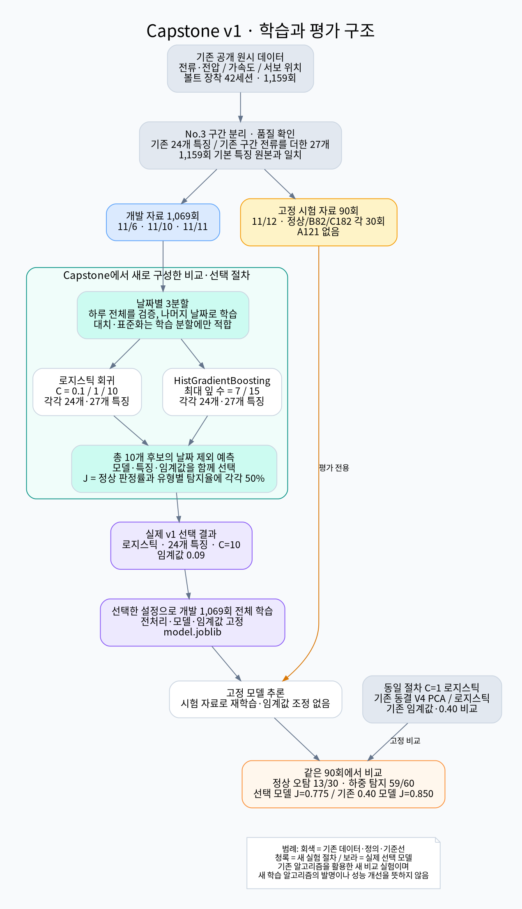
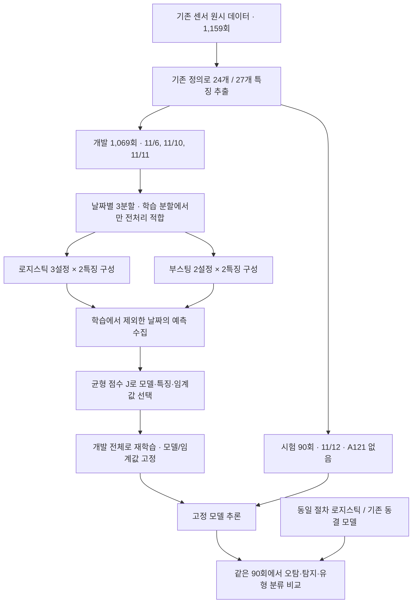
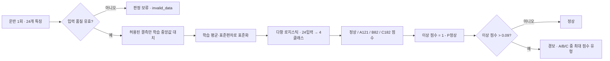

# Capstone v1 아키텍처와 기존 연구와의 차이

기존 공개 데이터와 특징 정의를 바탕으로 **날짜별 검증·후보 모델 비교·균형 목표에 따른 임계값 선택**을 새로 구성했습니다. 기존 저장 모델을 그대로 실행한 결과와 새 학습 결과를 분리해 비교합니다. 알고리즘 자체는 기존의 로지스틱 회귀와 HistGradientBoosting이며, 새 학습 알고리즘을 발명했다고 주장하지 않습니다.

[벡터 그림](architecture.svg) · [그림 원본](architecture.dot) · [실제 v1 결과 분석](../experiments/v1/ANALYSIS_KO.md)

## 학습·선택·평가

10개 후보의 개발 검증을 비교한 실제 선택 결과는 **24특징 로지스틱, C=10, 임계값 0.09**입니다. 27개 특징과 부스팅 후보는 이번 선택 점수에서 우세하지 않았습니다. 최종 모델은 후보들의 앙상블이 아니라 선택된 단일 모델입니다.

## 실제 선택 모델의 추론

로지스틱의 선형 계수는 4×24, 절편은 4개입니다. 정상 점수가 가장 큰 경우에도 정상 점수가 0.91보다 낮으면 경보가 날 수 있습니다. 이 규칙은 모델의 클래스 최대값을 그대로 출력하는 것과 다릅니다. 출력 점수는 별도 확률 보정을 거치지 않았습니다.

## 재사용과 변경의 경계

| 항목 | 기존 저장소 | Capstone v1 |
|---|---|---|
| 원시 자료 | 전류·전압, 가속도, 서보 위치 | 같은 공개 실측 자료의 볼트 장착 1,159회를 선택 |
| 기본 특징 | V4의 24개 특징 | 같은 수식·순서로 재현; 1,159회 최대 차이 0 |
| 확장 특징 | V3-C에 구간 전류 평균이 이미 존재 | 기존 24개+S3/S4/S5 평균의 27개 구성을 다시 비교 |
| 알고리즘 | PCA, 로지스틱, RF 등 | 로지스틱 규제 3설정과 표준 HistGradientBoosting 2설정 비교 |
| 전처리 | 학습 중앙값 대치·표준화 | 같은 원칙을 각 날짜별 학습 분할에 적용 |
| 검증 | 버전·캠페인별 고정 분할 및 후속 평가 | 세 개발 날짜를 하나씩 통째로 제외하는 공통 검증 |
| 임계값 | 정상 교정 점수 95백분위수; 후속 0.40 후보 평가 | 날짜 제외 예측에서 0–1, 0.01 간격으로 균형 목표 최적화 |
| 이상 점수·유형 | 1−P정상; 경보 시 이상 유형 최대 점수 | 같은 판정 형태를 유지 |
| 새 모델 학습 | 기존 캠페인별 저장 모델 | 개발 1,069회로 새 파라미터 학습 |
| 기존 저장 모델 | 각 실험의 산출물 | 최종 90회의 고정 비교 기준으로만 사용 |

따라서 v1은 **기존 기법을 이용한 새로운 실험 구성**입니다. 새 특징의 발명, 새 신경망 구조, 새 데이터 수집에 해당하지 않습니다. 이번 시험에서 최종 선택 모델이 기준선보다 우수하다는 결론도 나오지 않았습니다.

## 구현 위치와 출처

- [특징 추출](../capstone/features.py): No.3 시간창, 원시 표본 통계, 품질 확인.
- [모델 정의](../capstone/model.py): 전처리, 후보 분류기, 클래스 순서, 경보·보류 규칙.
- [학습 절차](../capstone/train.py): 날짜별 분할, OOF 예측, 임계값 선택, 전체 개발 자료 적합.
- [평가](../capstone/evaluate.py): 고정 모델과 동일 회차 비교. 평가 중 학습·임계값 변경 없음.

참고 코드는 [원본 고정 커밋](https://github.com/wplso/xArm-model-training/tree/2fdaa693e3aaafe3a221f5a775a12bc340f4d562)의 V4 특징 정의, V3 입력 구성, 볼트 지도학습 프로토콜입니다. 데이터·코드·모델 해시는 각 실행의 metadata와 공개 결과 스냅샷에 보존합니다.
