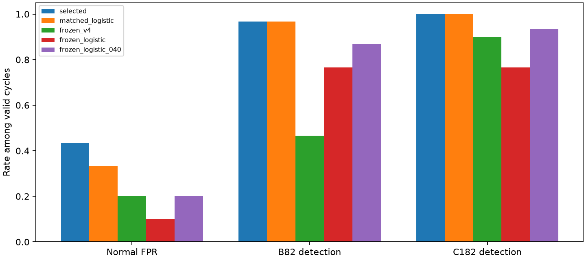
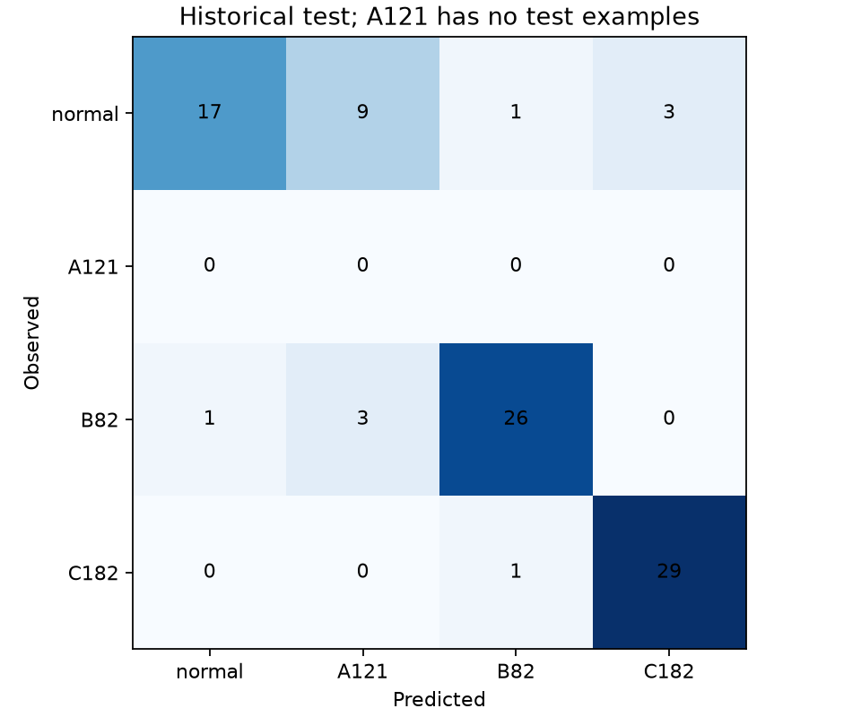
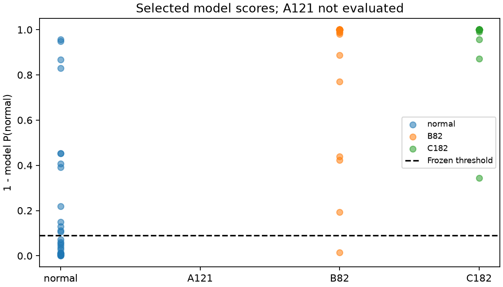
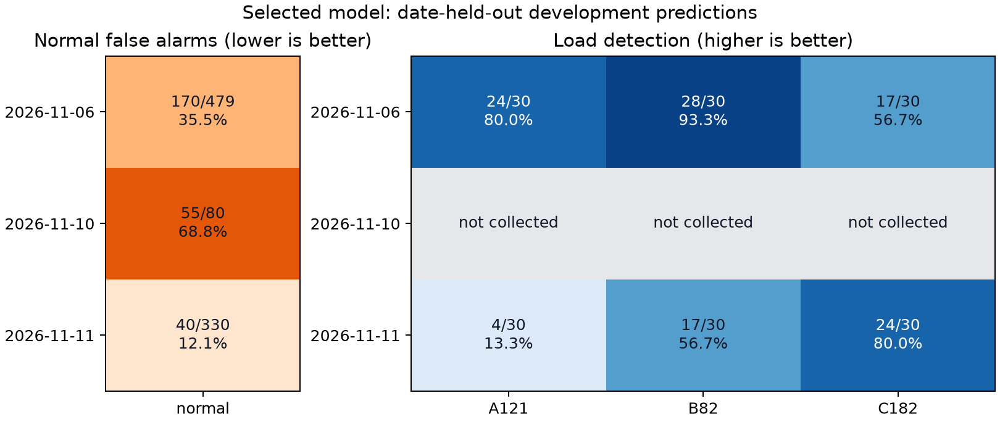
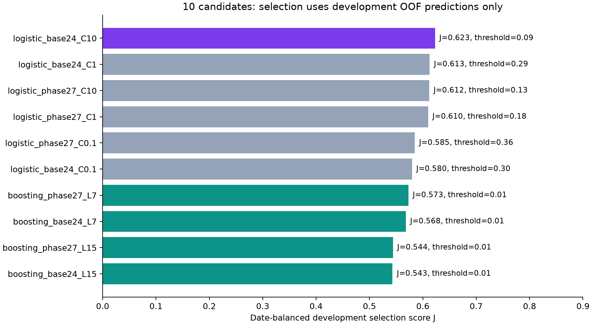

# Capstone v1 결과 분석

**v1은 하중 탐지율을 높였지만 정상 오탐이 늘어, 균형 성능 개선을 확인하지 못했습니다.** 개발 검증에서 선택된 모델은 기본 24특징 로지스틱 회귀(C=10), 임계값 0.09입니다. 시험 하중 60회 중 59회를 탐지했고, 정상 30회 중 13회에도 경보가 났습니다. 같은 시험 자료에서 기존 정상 확장 로지스틱의 0.40 임계값이 더 높은 균형 점수를 보였습니다.

사용자가 실행한 `runs/v1`과 `runs/v1/evaluatio`의 결과를 분석했습니다. 이 공개 스냅샷을 만드는 과정에서는 모델을 다시 학습하거나 임계값을 바꾸지 않았습니다. 실행 ID는 `06c6924f19d8`입니다.

## 무엇을 새로 실험했나

원시 자료, V4의 24특징, V3-C에 있는 구간 전류 특징, `1−P(정상)` 점수와 경보 시 유형 선택 규칙을 재사용했습니다. 새로 구성한 부분은 세 개발 날짜를 통째로 교차 검증하는 절차, HistGradientBoosting 후보, 24/27특징과 규제 설정의 공통 비교, 정상 판정률과 유형별 탐지율을 균형 있게 반영하는 임계값 선택입니다.

이는 기존 기법을 이용한 새로운 실험 구성입니다. 27개 특징 자체나 로지스틱·부스팅 알고리즘의 신규성을 주장하지 않습니다. 최종 선택 모델도 로지스틱이므로 새로운 신경망 아키텍처를 검증한 결과에 해당하지 않습니다. [전체 아키텍처와 재사용 범위](../../docs/ARCHITECTURE.md)

## 고정 시험셋 결과

11월 12일의 정상·B82·C182 각 30회, 총 90회를 비교했습니다. 전 회차가 품질 검사를 통과했고 판정 보류는 0회입니다. 아래 탐지 수는 정확한 하중 유형까지 맞혔는지와 무관하게 경보가 난 횟수입니다.

| 모델 | 임계값 | 정상 오탐 | B82 탐지 | C182 탐지 | 균형 점수 J | 유형 Macro-F1 |
|---|---:|---:|---:|---:|---:|---:|
| **선택 모델: 새 C=10 로지스틱** | **0.09** | **13/30 (43.3%)** | **29/30 (96.7%)** | **30/30 (100%)** | **0.775** | **0.847** |
| 같은 절차의 C=1 로지스틱 | 0.29 | 10/30 (33.3%) | 29/30 (96.7%) | 30/30 (100%) | 0.825 | 0.867 |
| 기존 동결 V4 PCA-Q | 0.079291 | 6/30 (20.0%) | 14/30 (46.7%) | 27/30 (90.0%) | 0.742 | 해당 없음 |
| 기존 정상 확장 로지스틱 | 0.821445 | 3/30 (10.0%) | 23/30 (76.7%) | 23/30 (76.7%) | 0.833 | 0.804 |
| 기존 정상 확장 로지스틱 | 0.40 | 6/30 (20.0%) | 26/30 (86.7%) | 28/30 (93.3%) | 0.850 | 0.849 |

시험 J는 `0.5 × 정상 판정률 + 0.5 × B82·C182 평균 탐지율`입니다. 유형 Macro-F1은 정답이 존재하는 정상·B82·C182 세 클래스의 평균이며, A121의 시험 성능을 의미하지 않습니다. [비교 수치](evaluation/comparison.csv) · [모든 지표와 분모](evaluation/metrics.json)

같은 회차의 경보를 직접 비교하면 다음과 같습니다. 정상의 추가 경보는 추가 오탐, 하중의 추가 경보는 추가 탐지입니다.

| 비교 대상 | v1에서만 정상 경보 | 비교 모델에서만 정상 경보 | v1에서만 하중 경보 | 비교 모델에서만 하중 경보 |
|---|---:|---:|---:|---:|
| 같은 절차의 C=1 | 4 | 1 | 0 | 0 |
| 기존 로지스틱 0.821445 | 10 | 0 | 13 | 0 |
| 기존 로지스틱 0.40 | 7 | 0 | 5 | 0 |

같은 절차의 C=1 모델은 v1과 정확히 같은 하중 59회를 탐지하면서 정상 경보는 총 3회 적었습니다. 기존 0.40 모델 대비로는 하중을 5회 더 탐지하는 대신 정상 오탐이 7회 늘었습니다. 이 시험의 집계 성능으로 v1의 개선을 주장할 수 없습니다. 표는 모델·임계값이 함께 다른 비교이므로 차이를 특정 설정 하나의 효과로 단정하지 않습니다. [회차별 경보 변화](analysis/paired_alarm_changes.csv)

## 오탐과 유형 오류

선택 모델의 유형 혼동은 다음과 같습니다. 행은 실제 조건, 열은 출력 유형입니다.

| 실제 조건 | 정상 출력 | A121 출력 | B82 출력 | C182 출력 |
|---|---:|---:|---:|---:|
| 정상 | 17 | 9 | 1 | 3 |
| B82 | 1 | 3 | 26 | 0 |
| C182 | 0 | 0 | 1 | 29 |

정상 오탐 13회 중 9회가 A121 출력이었습니다. B82는 29회 경보 중 26회만 유형까지 일치했고, C182는 30회 경보 중 29회가 유형까지 일치했습니다. 전체 유형 일치는 72/90회입니다. [혼동행렬](evaluation/confusion.csv) · [정상 오탐 회차와 점수](analysis/normal_false_alarms.csv)

임계값 0.09는 정상 점수가 0.91보다 낮으면 경보를 내는 설정입니다. 따라서 정상 점수가 다른 개별 클래스보다 높더라도 경보가 발생할 수 있습니다. 이는 높은 탐지율과 함께 해석해야 합니다. 다만 일부 정상 오탐의 이상 점수는 0.8 이상이므로 모든 오탐을 낮은 임계값 하나로 설명할 수는 없습니다.

선택 모델의 B82/정상 AUROC는 0.9489, C182/정상 AUROC는 0.9878이었습니다. 점수 순위의 분리와 고정 임계값에서의 오탐은 다른 지표입니다. 높은 AUROC만으로 현재 경보 설정이 적절하다고 판단하지 않습니다.

## 개발 단계에서 드러난 날짜 차이

세 날짜 중 하루 전체를 제외하고 나머지 날짜로 학습했습니다. 아래는 각 날짜가 학습에 포함되지 않았을 때의 예측에 선택 임계값을 적용한 결과입니다. 각 행은 서로 다른 학습 분할의 모델에서 나온 값이며, 이 OOF 예측은 모델·임계값 선택에도 사용됐습니다.

| 검증 날짜 | 정상 오탐 | A121 탐지 | B82 탐지 | C182 탐지 |
|---|---:|---:|---:|---:|
| 11월 6일 | 170/479 (35.5%) | 24/30 (80.0%) | 28/30 (93.3%) | 17/30 (56.7%) |
| 11월 10일 | 55/80 (68.8%) | 자료 없음 | 자료 없음 | 자료 없음 |
| 11월 11일 | 40/330 (12.1%) | 4/30 (13.3%) | 17/30 (56.7%) | 24/30 (80.0%) |

A121은 검증 날짜에 따라 탐지가 80.0%와 13.3%로 달랐고, 11월 10일 정상의 오탐도 높았습니다. 이번 자료에서는 날짜가 달라졌을 때 판정이 안정적이지 않다는 관측을 얻었습니다. 온도·재가동·센서 상태 중 어느 요인이 물리적 원인인지는 이 결과만으로 분리할 수 없습니다. [날짜별 수치](analysis/selected_oof_by_date.csv)

선택 모델의 개발 J는 0.6227, 같은 절차 C=1의 개발 J는 0.6127로 차이가 약 0.0100이었습니다. 소수의 수집 날짜에서 얻은 작은 개발 점수 우위가 최종 시험 우위로 이어지지 않았습니다. 개발은 A/B/C, 시험은 B/C만 포함하므로 두 J의 절대값을 직접 비교해 일반화 정도를 계산하지 않습니다.

## 부스팅과 27특징의 결과

- 기본 24특징 로지스틱 C=10: 개발 J **0.6227**, 선택됨.
- 확장 27특징의 최상 후보인 로지스틱 C=10: 개발 J **0.6120**.
- 부스팅의 최상 후보인 27특징·최대 잎 7개: 개발 J **0.5729**.

이번 고정 탐색 범위에서는 구간 전류 3개 추가나 부스팅 도입이 최상 개발 점수를 높이지 않았습니다. 다른 설정이나 다른 데이터까지 효과가 없다는 의미는 아닙니다. 각 후보는 자기 OOF 예측으로 고른 임계값을 사용했으며, 시험 결과로 후보나 임계값을 재선택하지 않았습니다. [전체 후보](candidates.csv) · [임계값 탐색](threshold_sweep.csv)

## 결론과 해석 범위

1. v1의 장점은 이번 시험에서 하중 60회 중 59회를 탐지한 것입니다. 정상 오탐 43.3%를 함께 고려하면 목표로 한 균형 성능의 개선은 확인되지 않았습니다.
2. 정상/A121 구분과 날짜 간 변화가 후속 연구에서 확인할 핵심 항목입니다. 임계값 조정만으로 이 문제가 해결된다고 단정할 수 없습니다.
3. 최종 시험에 A121이 없고, B/C도 한 날짜의 각 30회입니다. 모든 하중·날짜·자연 고장에 대한 일반화 성능을 주장하지 않습니다.
4. 공개 결과는 이미 분석된 기존 자료의 회고 평가입니다. 이후 이 시험 결과를 참고해 설계를 바꾸면 같은 90회를 새로운 독립 시험으로 다시 표현하지 않습니다.
5. 시험 결과를 보고 선택 모델을 바꾸지 않고 C=10·0.09 번들을 그대로 보존했습니다. 운영 모델 승격이나 자동 재학습은 수행하지 않았습니다.

## 재현 자료

- [학습 설정](config.json), [실행·선택 근거](metadata.json), [날짜 분할](folds.csv), [데이터 분할](data_splits.csv)
- [선택 모델](model.joblib), [동일 절차 기준 모델](baseline.joblib), [OOF 예측](oof_predictions.csv), [시험 예측](evaluation/predictions.csv)
- [원본 특징 재현](feature_parity.csv), [데이터 출처와 해시](data_provenance.json), [공개 파일 해시](snapshot.json)
- [분석·스냅샷 생성 코드](../../scripts/archive_run.py), [구현 검증 기록](../../docs/VALIDATION.json)

기본 24개 특징은 1,159회 모두 원본 저장값과 최대 절대 차이 0으로 일치했습니다. 공개 전에 저장된 예측으로 지표를 다시 계산했고, 모델·데이터·소스 해시 및 복사한 파일의 바이트 일치를 확인했습니다. 대용량 원시 파일은 원본 저장소의 고정 커밋에서 다시 받을 수 있습니다.
